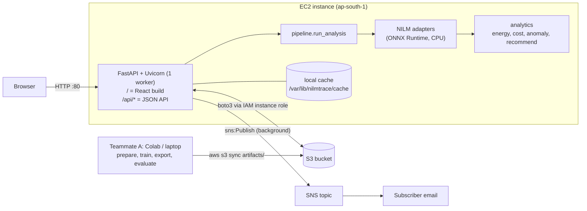
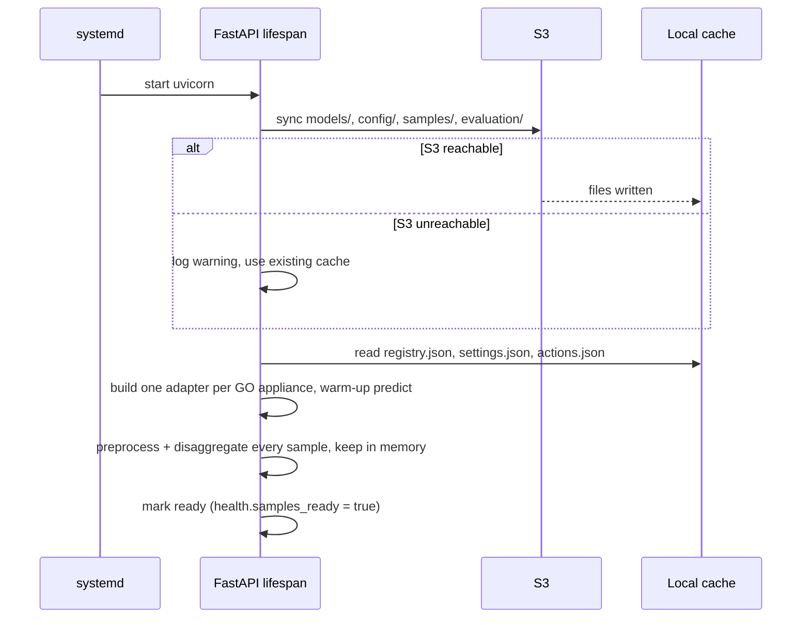
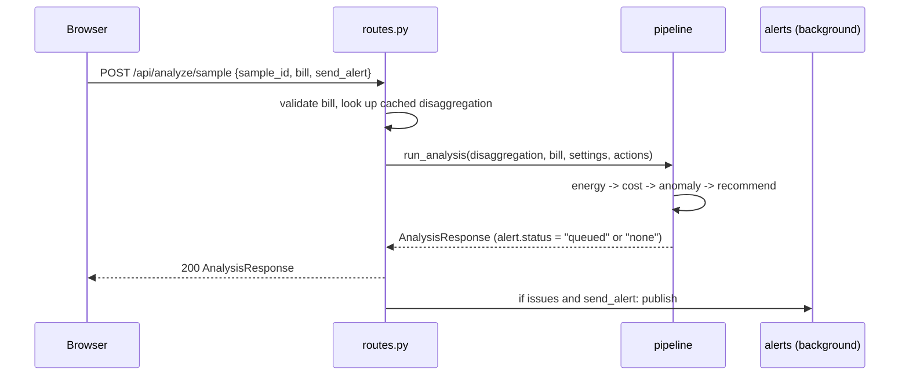
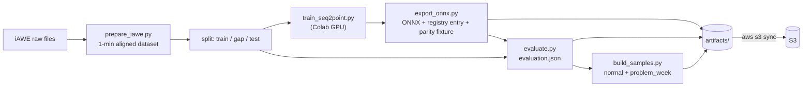

# ARCHITECTURE.md — NILMTrace technical design

This is the **authoritative technical definition** of NILMTrace. Every API contract, artifact schema, preprocessing rule and analytics rule is defined **once, here**. Other files link to the relevant section; they do not restate it.

- Product scope and features: [PROJECT.md](PROJECT.md)
- Acceptance criteria: [REQUIREMENTS.md](REQUIREMENTS.md)
- Why each decision was made, and what changed from the original architecture PDF: [DECISIONS.md](DECISIONS.md)
- How to run it on AWS: [DEPLOYMENT.md](DEPLOYMENT.md)

Items marked **⚠ UNRESOLVED (U-xx)** depend on experiments. They are tracked in [DECISIONS.md §4](DECISIONS.md#4-unresolved-decisions) and must not be treated as proven.

---

## 1. Design principles

1. **One process, one instance.** A single FastAPI app on one EC2 instance serves the React build and the API from one origin. No microservices.
2. **The appliance set is data, not code.** `models/registry.json` decides which appliances exist. No appliance id is hard-coded in the backend or frontend (except the reserved id `other`).
3. **AI only where it is needed.** NILM inference is the only ML. Everything downstream is deterministic Python/NumPy.
4. **The demo never waits on inference.** Sample scenarios are disaggregated once at startup and cached in memory.
5. **What was evaluated is what runs.** The offline evaluation script imports the backend's own preprocessing, adapter and analytics code.
6. **Honest numbers only.** Every number shown in the UI is computed from data by code in this repository. Nothing is typed by hand.

---

## 2. System overview



Request-time components all run inside one Python process on EC2. S3 and SNS are the only external dependencies. Training happens offline and reaches production only as files in S3.

### Component ownership

| Component | Path | Owner | Responsibility |
|---|---|---|---|
| App entry, startup | `backend/app/main.py` | B | FastAPI app, `lifespan` startup, static files, router |
| Settings | `backend/app/config.py` | B | Environment variables (§15) |
| Contracts | `backend/app/schemas.py` | B | Pydantic models of §6 |
| Routes | `backend/app/api/routes.py` | B | Endpoints of §6.1 |
| CSV validation | `backend/app/ingest/validate.py` | B | Rules of §7.5 (P1) |
| Preprocessing | `backend/app/ingest/preprocess.py` | A | Rules of §8 (shared with training) |
| Registry + adapters | `backend/app/nilm/registry.py`, `adapters.py` | A | §9 |
| Postprocessing | `backend/app/nilm/postprocess.py` | A | §9.4 |
| Energy | `backend/app/analytics/energy.py` | A | §10.1–10.2 |
| Anomaly | `backend/app/analytics/anomaly.py` | A | §10.4–10.6 |
| Cost | `backend/app/analytics/cost.py` | B | §10.3 |
| Recommendations, savings | `backend/app/analytics/recommend.py` | B | §10.7–10.9 |
| Pipeline | `backend/app/pipeline.py` | A | Orchestrates §8 → §10 |
| Storage | `backend/app/storage.py` | B | S3 ↔ local cache (§12) |
| Alerts | `backend/app/alerts.py` | B | SNS email (§10.10) |
| Frontend | `frontend/` | B (see U-04) | Screens of §13 |
| Offline ML | `ml/` | A | Data prep, training, export, evaluation, samples (§11) |

Teammate A = ML/data. Teammate B = backend/cloud. Ownership means "writes and maintains"; both may read and review everything.

---

## 3. AWS services

Three services plus IAM. All resources are in **ap-south-1 (Mumbai)**.

| Service | Job in the product | Data | Connects to | Simpler alternative rejected |
|---|---|---|---|---|
| **Amazon S3** (one private bucket) | Source of truth for every artifact the app reads | Models, registry, config, samples, evaluation, raw uploads (P1) | EC2 reads at startup; Teammate A uploads with `aws s3 sync` | Local disk only: lost if the instance is replaced, and Teammate A would need SSH to ship a model |
| **Amazon EC2** (one instance, `t3.medium` proposed — U-08) | Runs the API, NILM inference, analytics, and serves the frontend | Signals in memory; local cache of S3 | Browser over HTTP; S3/SNS via boto3 | Lambda (ML package size, cold starts), App Runner (container build + ECR), SageMaker endpoint (more moving parts than a small CPU model needs), Amplify (cross-origin + mixed content with an HTTP API) |
| **Amazon SNS** (one standard topic, email subscription) | Sends the overuse alert email | Alert text only | FastAPI background task → `sns:Publish` | SES: needs a verified sender, and sandbox mode requires verified recipients |
| **IAM** | Instance role for EC2; scoped IAM user for Teammate A | — | — | Access keys on the server: leak risk |

Exact IAM policies: [DEPLOYMENT.md §3](DEPLOYMENT.md#3-iam).

**Accepted SNS limitation:** an email goes to every confirmed subscriber of the topic, not to a per-user address. For the MVP the subscriber is the team's demo inbox.

---

## 4. Request flows

### 4.1 Startup



A failed adapter is logged and skipped; the app still starts (§14). If `NILM_SYNC_ON_STARTUP=false`, the S3 step is skipped and the cache directory is used as is (local development and laptop fallback).

### 4.2 Sample analysis (the demo path)



### 4.3 Upload analysis (P1)

`POST /api/analyze/upload` → size check → save raw file to `uploads/{analysis_id}/raw.csv` → `validate` (§7.5) → `preprocess` (§8) → `adapters.predict` for each GO appliance → `postprocess` (§9.4) → same steps as 4.2.

---

## 5. Data types and provenance

The system handles three kinds of data. They are never mixed in one claim.

| Kind | Where it appears | What it can support |
|---|---|---|
| **Real validation** | `evaluation.json`, F3 evaluation panel | Claims about model accuracy on held-out iAWE data |
| **Simulated demonstration** | `problem_week` sample (`source.simulated = true`) | Showing how the product behaves; never a claim about a real household |
| **Model estimate on user data** | Upload path (P1), and the dashboard view of any sample | Estimates only; no ground truth exists to check them |

The `normal` sample is real iAWE aggregate data from the held-out test period, analysed by the model. Its appliance figures are still **estimates**, because the dashboard shows model output, not the submeters.

---

## 6. API contracts (authoritative)

`backend/app/schemas.py` implements these as Pydantic models. `frontend/src/types.ts` mirrors them. Example payloads live in `frontend/src/mocks/` and are validated against the Pydantic models by test `TS-C-01` ([TESTING.md](TESTING.md)).

Conventions: JSON field names are `snake_case`. Timestamps are ISO 8601 with offset `+05:30`. Numbers that cannot be computed are `null`, never `0` or `NaN`.

### 6.1 Endpoints

| Method | Path | Priority | Request | Success response | Errors |
|---|---|---|---|---|---|
| GET | `/api/health` | P0 | — | `HealthResponse` (always 200) | — |
| GET | `/api/config` | P0 | — | `ConfigResponse` | 503 `not_ready` |
| POST | `/api/analyze/sample` | P0 | `SampleRequest` (JSON) | `AnalysisResponse` | 400 `bad_bill`, 404 `unknown_sample`, 503 `not_ready`, 500 `internal` |
| GET | `/api/evaluation` | P0 | — | `EvaluationResult` | 503 `not_ready` |
| POST | `/api/analyze/upload` | P1 | `multipart/form-data` (§6.4) | `AnalysisResponse` | 400 `bad_bill`, 413 `too_large`, 422 (§6.9), 500 `internal` |

All other paths under `/api/` return 404 JSON. Any non-`/api` path serves the React app (`index.html` fallback).

### 6.2 Shared types

```ts
type ApplianceId = string;   // from registry.json; "other" is reserved for the residual
type Status = "normal" | "flagged" | "insufficient_history" | "not_monitored"; // "not_monitored" only for "other"
type Driver = "longer_operating_time" | "higher_power_when_on";
interface Range { low: number; mid: number; high: number }
interface Period { start: string; end: string }   // end is exclusive
```

### 6.3 `SampleRequest`

```ts
interface SampleRequest {
  sample_id: string;           // one of ConfigResponse.samples[].id
  bill?: Bill | null;          // omitted or null => the sample's default_bill
  send_alert?: boolean;        // default true
}
interface Bill {
  amount_inr?: number;         // > 0
  units_kwh?: number;          // > 0
  cost_per_kwh_inr?: number;   // > 0, alternative to amount + units
}
```

A `Bill` is valid if (`amount_inr` > 0 **and** `units_kwh` > 0) **or** `cost_per_kwh_inr` > 0. If both forms are present, amount ÷ units wins. Otherwise → 400 `bad_bill`.

### 6.4 Upload request (P1)

`POST /api/analyze/upload`, `multipart/form-data`:

| Field | Type | Required |
|---|---|---|
| `file` | CSV, format of §7.5 | yes |
| `bill_amount_inr` | number > 0 | with `bill_units_kwh`, unless `cost_per_kwh_inr` |
| `bill_units_kwh` | number > 0 | with `bill_amount_inr`, unless `cost_per_kwh_inr` |
| `cost_per_kwh_inr` | number > 0 | alternative |
| `send_alert` | `"true"` / `"false"` | no, default `"true"` |

### 6.5 `AnalysisResponse`

```ts
interface AnalysisResponse {
  analysis_id: string;                       // "a_" + 8 hex chars
  source: {
    kind: "sample" | "upload";
    sample_id: string | null;
    simulated: boolean;                      // true only for simulated scenarios
    description: string | null;              // from scenario.json, shown in the methodology drawer
  };
  period: Period & {
    weeks_analyzed: number;                  // 3..5
    weeks_valid: number;                     // weeks with coverage >= week_min_coverage
    days_in_period: number;                  // 7 * weeks_valid
  };
  cost: {
    bill_amount_inr: number | null;
    bill_units_kwh: number | null;
    effective_cost_per_kwh_inr: number;
    bill_is_illustrative: boolean;           // true when a sample's default bill was used
  };
  summary: {
    total_kwh_period: number;                // aggregate signal, §10.2
    estimated_cost_period_inr: number;
    largest_consumer: ApplianceId | null;    // among monitored appliances only
    issues_count: number;
    possible_savings_inr_per_month: Range | null;  // sum over issues; null if no issues
  };
  appliances: ApplianceResult[];             // registry order, then "other" last
  issues: Issue[];                           // ranked, may be empty
  signals: {
    interval_minutes: 15;
    start: string;                           // start of W0
    aggregate_w: (number | null)[];          // 672 points = W0 at 15-min means
    by_appliance: Record<ApplianceId, (number | null)[]>;  // includes "other"
  };
  co2: {
    factor_kg_per_kwh: number | null;        // null => CO2 not shown
    source: string | null;
  };
  alert: { status: "queued" | "none" | "disabled" | "not_requested" };
  model: { registry_version: number; appliances_loaded: ApplianceId[] };
}
```

### 6.6 `ApplianceResult`

```ts
interface ApplianceResult {
  id: ApplianceId;
  name: string;
  kwh_period: number;
  cost_period_inr: number;
  share_pct: number;                         // of summary.total_kwh_period
  status: Status;
  this_week_kwh: number;                     // W0
  baseline_kwh: number | null;               // null when insufficient_history or "other"
  daily_kwh: { date: string; kwh: number | null }[];   // one entry per day of the period
}
```

### 6.7 `Issue` (includes the recommendation)

```ts
interface Issue {
  rank: number;                              // 1 = highest possible ₹ savings
  appliance_id: ApplianceId;
  appliance_name: string;
  this_week_kwh: number;
  baseline_kwh: number;
  change_pct: number | null;                 // null when baseline_kwh == 0
  threshold_pct: number;                     // T * 100 used for this appliance
  driver: Driver;
  driver_text: string;                       // "The increase is primarily associated with ..."
  on_hours: { this_week: number; baseline: number };
  avg_on_power_w: { this_week: number | null; baseline: number | null };
  explanations: string[];                    // from actions.json
  recommendation: Recommendation;
}
interface Recommendation {
  action: string;                            // from actions.json
  savings: {
    label: "Possible savings if use returns to its normal level";
    kwh_per_month: Range;
    inr_per_month: Range;
    co2_kg_per_month: Range | null;          // null when no CO2 factor configured
  };
}
```

### 6.8 `EvaluationResult`

Produced offline by `ml/evaluate.py` (§11). Served unchanged by `GET /api/evaluation`.

```ts
interface EvaluationResult {
  label: "Model evaluation on data not used in training";
  generated_at: string;
  code_version: string;                      // git commit hash used for the run
  registry_version: number;
  dataset: {
    name: "iAWE";
    houses: 1;
    interval_minutes: 1;
    train_period: Period;
    gap_minutes: number;
    test_period: Period;
    test_weeks_valid: number;
  };
  appliances: ApplianceEvaluation[];         // GO and NO-GO candidates
}
interface ApplianceEvaluation {
  id: ApplianceId;
  name: string;
  decision: "go" | "no_go";
  decision_note: string;                     // the reason, in one or two sentences
  test_on_events: number;                    // ON events in the test period
  model: Metrics;
  naive_baseline: Metrics;                   // §11.3
  rule_baseline: Metrics | null;             // optional (P1), AC only
  weekly: { week_start: string; predicted_kwh: number; actual_kwh: number }[];
  downstream_check: {
    injected_increase_pct: number;
    threshold_pct: number;
    injected_week_flagged: boolean;
    normal_weeks_checked: number;
    false_flags: number;
    note: string;                            // states the small sample size honestly
  } | null;
  example_window: {
    selection_rule: string;                  // e.g. "test day with median daily MAE"
    start: string;
    interval_minutes: 1;
    aggregate_w: (number | null)[];          // 1440 points
    predicted_w: (number | null)[];
    actual_w: (number | null)[];
  } | null;
}
interface Metrics {
  mae_w: number;
  total_energy_error_pct: number;
  weekly_energy_error_pct: { median: number; max: number };
  on_off: { precision: number; recall: number; f1: number };
}
```

### 6.9 `ConfigResponse`, `HealthResponse`, `ErrorResponse`

```ts
interface ConfigResponse {
  registry_version: number;
  appliances: { id: ApplianceId; name: string; color_index: number }[];  // GO + loaded only, registry order; "other" last
  samples: {
    id: string; name: string; description: string; simulated: boolean;
    default_bill: { amount_inr: number; units_kwh: number };
    bill_is_illustrative: true;
  }[];
  limits: { max_upload_mb: number; min_days: number; max_median_interval_s: number };
  upload_enabled: boolean;                   // false until the P1 upload path is shipped
}

interface HealthResponse {
  status: "ok" | "degraded" | "starting";
  registry_version: number | null;
  appliances_loaded: ApplianceId[];
  appliances_failed: ApplianceId[];
  samples_ready: boolean;
  s3_synced: boolean;
}

interface ErrorResponse { error: { code: string; message: string; analysis_id?: string } }
```

| HTTP | `code` | When |
|---|---|---|
| 400 | `bad_bill` | Bill rule of §6.3 fails |
| 404 | `unknown_sample` | `sample_id` not in config |
| 413 | `too_large` | Upload over `max_upload_mb` |
| 422 | `bad_format` | Not parseable as CSV |
| 422 | `missing_columns` | Header is not `timestamp,power_w` |
| 422 | `bad_timestamps` | A timestamp cannot be parsed |
| 422 | `values_out_of_range` | Power < 0, > `max_power_w`, or max < 50 W (looks like kW) |
| 422 | `interval_too_coarse` | Median sample interval > `max_median_interval_s` |
| 422 | `insufficient_history` | < `min_analysis_weeks` whole weeks, or W0 coverage below `week_min_coverage` |
| 500 | `internal` | Unhandled pipeline error; `analysis_id` included |
| 503 | `not_ready` | Startup not finished |

`message` is one plain-language sentence a user can act on.

---

## 7. Artifact schemas (authoritative)

Artifacts live in S3 (§12) and are mirrored in the repo under `artifacts/` (JSON committed; `.onnx` and `.csv` git-ignored).

### 7.1 `models/registry.json` — written by `ml/export_onnx.py`

```json
{
  "registry_version": 1,
  "input_interval_seconds": 60,
  "appliances": [
    {
      "id": "ac",
      "name": "Air conditioner",
      "status": "go",
      "adapter": "onnx_seq2point",
      "model_path": "models/ac/v1/model.onnx",
      "window": 99,
      "norm": { "mains_mean": 0.0, "mains_std": 1.0, "app_mean": 0.0, "app_std": 1.0 },
      "on_threshold_w": 0.0,
      "weekly_energy_error_pct": 0.0,
      "min_excess_kwh_week": 0.0,
      "note": ""
    },
    { "id": "washing_machine", "name": "Washing machine", "status": "no_go", "note": "reason from evaluation" }
  ]
}
```

- Values shown are placeholders. `norm`, `on_threshold_w` and `weekly_energy_error_pct` are written by scripts from the same run that writes `evaluation.json`. **Never typed by hand.**
- `adapter: "rule_step"` (AC fallback, P2 unless AC is NO-GO) replaces `model_path`/`window`/`norm` with `rule_params: { "step_w": number, "min_on_minutes": number }`.
- `window` ⚠ U-05 (proposed 99 samples). `id` matches `^[a-z][a-z0-9_]*$` and must not be `other`.
- Entries with `status: "no_go"` stay in the file so the methodology drawer can list them.

### 7.2 `config/settings.json` — maintained by Teammate B

```json
{
  "co2_factor_kg_per_kwh": null,
  "co2_source": null,
  "threshold_floor": 0.25,
  "threshold_error_multiplier": 2.0,
  "week_min_coverage": 0.8,
  "day_min_coverage": 0.5,
  "min_baseline_weeks": 2,
  "min_analysis_weeks": 3,
  "max_analysis_weeks": 5,
  "gap_fill_max_minutes": 5,
  "max_upload_mb": 20,
  "max_power_w": 30000,
  "max_median_interval_s": 60,
  "signals_interval_minutes": 15
}
```

`co2_factor_kg_per_kwh` and `co2_source` ⚠ U-07: fill from the latest edition of the CEA CO2 Baseline Database (task T-208). While `null`, CO₂ values are `null` and the UI hides them.

### 7.3 `config/actions.json` — maintained by Teammate B

```json
{
  "ac": {
    "longer_operating_time": {
      "action": "Check the AC schedule. Switch it off in empty rooms and use the timer.",
      "explanations": ["Longer operating hours", "Hotter weather than in the baseline weeks", "Lower thermostat setting"]
    },
    "higher_power_when_on": {
      "action": "Clean the filters and book a service check. Set the temperature to 24–26 °C.",
      "explanations": ["Maintenance condition (filters, coils)", "Lower thermostat setting", "Hotter weather than in the baseline weeks"]
    }
  },
  "fridge": {
    "longer_operating_time": {
      "action": "Check the door seal. Do not put hot food inside. Keep the door closed.",
      "explanations": ["Door opened more often", "Worn door seal", "Warmer room"]
    },
    "higher_power_when_on": {
      "action": "Clean the condenser coils. Leave space behind the fridge for air flow. Check the temperature setting.",
      "explanations": ["Maintenance condition", "Colder setting", "Warmer room"]
    }
  },
  "washing_machine": {
    "longer_operating_time": {
      "action": "Run full loads only. Use the shorter or eco cycle.",
      "explanations": ["More wash cycles", "Longer programs"]
    },
    "higher_power_when_on": {
      "action": "Use cold or lower-temperature washes.",
      "explanations": ["Hot-water programs", "Heavier loads"]
    }
  },
  "_default": {
    "longer_operating_time": { "action": "Review when and how long this appliance runs.", "explanations": ["Longer operating hours"] },
    "higher_power_when_on": { "action": "Check the appliance settings and maintenance condition.", "explanations": ["Settings", "Maintenance condition"] }
  }
}
```

No string may contain the words in §10.11.

### 7.4 `samples/{sample_id}/scenario.json` and `aggregate.csv` — written by `ml/build_samples.py`

```json
{
  "id": "problem_week",
  "name": "Problem week",
  "description": "Real iAWE aggregate from held-out weeks. In the last week, the measured AC signal was increased by a simulated amount and added to the aggregate.",
  "simulated": true,
  "source": { "dataset": "iAWE", "split": "test", "period": { "start": "…", "end": "…" } },
  "modification": { "appliance_id": "ac", "week": "W0", "increase_pct": 0 },
  "default_bill": { "amount_inr": 0, "units_kwh": 0 },
  "illustrative_rate_inr_per_kwh": 0,
  "bill_is_illustrative": true
}
```

- Two samples: `normal` (`simulated: false`, `modification: null`) and `problem_week`.
- Both cover exactly **3 whole weeks of the held-out test period** (W2, W1, W0). No training data.
- `modification.increase_pct` ⚠ U-03: set after evaluation to at least `T × 100 + 15` for the AC (§11.5). Same construction as the downstream check.
- `default_bill.units_kwh` = round(sample aggregate kWh × 30 ÷ 21). `amount_inr` = round(units × `illustrative_rate_inr_per_kwh`). The rate ⚠ U-09 is chosen by the team from a published residential tariff and cited in the README.
- `aggregate.csv` uses the upload format of §7.5.

### 7.5 Aggregate CSV format (uploads and samples)

```csv
timestamp,power_w
2026-01-01T00:00:00+05:30,412.5
2026-01-01T00:01:00+05:30,415.0
```

- Header exactly `timestamp,power_w`.
- `timestamp`: ISO 8601. Without an offset it is read as Asia/Kolkata local time.
- `power_w`: whole-house active power in **watts**, 0 ≤ value ≤ `max_power_w`.
- Median interval between samples ≤ `max_median_interval_s` (60 s).
- After cleaning, at least `min_analysis_weeks` (3) whole weeks.
- File ≤ `max_upload_mb` (20 MB). 1-second data longer than about a week exceeds this; users downsample to 1 minute first.

---

## 8. Preprocessing (shared by training and serving)

Implemented once in `backend/app/ingest/preprocess.py`. `ml/` scripts import it (`PYTHONPATH=backend`). Function: `preprocess(df) -> PreparedSignal`.

1. Parse timestamps. Naive → localise to Asia/Kolkata. Aware → convert to Asia/Kolkata.
2. Sort by timestamp; drop duplicate timestamps (keep first).
3. Resample to a 1-minute grid (`resample("1min").mean()`), grid aligned to whole minutes.
4. Fill gaps of at most `gap_fill_max_minutes` (5) by linear interpolation **inside** the series only. Longer gaps stay `NaN`.
5. Define the analysis window: end = the last local midnight (00:00 IST) after which no complete day remains; `weeks_analyzed = min(max_analysis_weeks, floor(complete_days / 7))`. Fewer than `min_analysis_weeks` → `insufficient_history`. Week W0 is the most recent 7 days; W1…W4 precede it.
6. A week is **valid** if ≥ `week_min_coverage` of its minutes are non-NaN. W0 invalid → `insufficient_history`.
7. Output `PreparedSignal`: `start` (window start), `aggregate_w` (float32 array, NaN = missing), `weeks` (list of `(label, start_idx, end_idx, valid)`).

Training applies steps 1–4 to the aggregate **and** to every appliance channel, on the same grid, before any split.

---

## 9. NILM integration

### 9.1 Model I/O contract

| Item | Contract |
|---|---|
| File | ONNX, one per appliance, opset ≥ 17, at `models/{id}/v{n}/model.onnx` |
| Input | name `aggregate`, `float32 [batch, window]`, normalised as `(x − mains_mean) / mains_std` |
| Output | name `appliance`, `float32 [batch, 1]` = appliance power at the window centre, normalised with `app_mean` / `app_std` |
| Window | odd length `window` (⚠ U-05); stride 1 |
| Padding | `window // 2` samples each side with the edge value; output length = input length |
| Missing input | NaN replaced by 0 W before normalisation; those minutes are set back to NaN after prediction |

### 9.2 Adapters (`backend/app/nilm/adapters.py`)

Both implement `predict(aggregate_w: np.ndarray) -> np.ndarray` (same length, watts, NaN where input was NaN).

- **`OnnxSeq2Point`**: normalise → pad → `numpy.lib.stride_tricks.sliding_window_view` → ONNX Runtime `InferenceSession.run` in batches of 2048 → denormalise → clip at 0.
- **`RuleStepDetector`** (fallback): detects upward/downward steps larger than `step_w` lasting ≥ `min_on_minutes`; assigns the step power to the appliance while ON. Used only if it is evaluated with the same metrics (§11) and marked `go`.

### 9.3 Registry loading (`backend/app/nilm/registry.py`)

- Read `registry.json`; validate against §7.1.
- For each entry with `status == "go"`: build its adapter, run one warm-up prediction on 1 day of zeros.
- A failing entry is logged, added to `appliances_failed`, and skipped. The app continues.

### 9.4 Postprocessing (`backend/app/nilm/postprocess.py`)

Per minute, for valid (non-NaN) aggregate minutes:

1. Clip every appliance estimate to `[0, aggregate]`.
2. If the sum of estimates exceeds the aggregate, scale all estimates down proportionally so the sum equals the aggregate.
3. `other = aggregate − sum(estimates)`.

Invariant: `sum(estimates) + other == aggregate` at every valid minute (tested, TS-U-11).

### 9.5 Adding or removing an appliance (no code change)

- **Add:** train → `ml/export_onnx.py` writes `artifacts/models/{id}/v{n}/model.onnx` and the registry entry → add an `actions.json` entry (or rely on `_default`) → rerun `ml/evaluate.py` → `aws s3 sync artifacts/ s3://<bucket>/` → restart the service.
- **Remove:** set `status` to `"no_go"` with a `note` → sync → restart.
- **Roll back a model:** point `model_path` at the previous `v{n}` → sync → restart.

The frontend renders whatever `/api/config` and `AnalysisResponse` contain.

---

## 10. Analytics rules (deterministic)

All inputs are 1-minute arrays from §8/§9. All rules have unit tests (TESTING.md, TS-U-03…TS-U-10).

### 10.1 Weekly and daily energy

For each series (aggregate, each appliance, `other`) and each **valid** week:

| Value | Rule |
|---|---|
| `kwh_week` | mean of valid minutes (W) × 168 h ÷ 1000 (normalised to a full week) |
| `on_hours_week` | (ON minutes ÷ valid minutes) × 168, where ON = watts > `on_threshold_w` |
| `avg_on_power_w` | mean watts over ON minutes; `null` if there are none |
| `daily_kwh` | per day: mean of valid minutes × 24 ÷ 1000 if day coverage ≥ `day_min_coverage`, else `null` |

### 10.2 Period totals

- `kwh_period` = Σ `kwh_week` over valid weeks; `days_in_period` = 7 × valid weeks.
- `summary.total_kwh_period` = the same for the aggregate.
- `share_pct` = `kwh_period` ÷ `total_kwh_period` × 100.
- `largest_consumer` = monitored appliance with the highest `kwh_period` (`other` excluded).

### 10.3 Cost

- `effective_cost_per_kwh_inr` = `amount_inr ÷ units_kwh`, or `cost_per_kwh_inr` (§6.3).
- `cost_period_inr` = `kwh_period × effective_cost_per_kwh_inr`.
- Labelled "Estimated cost contribution". It is an approximation: bills include fixed charges, slabs and taxes.

### 10.4 Baseline

`baseline_kwh` = median of `kwh_week` over the valid weeks among W1…W4. At least `min_baseline_weeks` (2) are required; otherwise `status = "insufficient_history"`. The same median rule gives `baseline on_hours` and `baseline avg_on_power_w`.

### 10.5 Flag (MVP heuristic)

```
e      = weekly_energy_error_pct / 100            (from registry, median weekly error)
T      = max(threshold_floor, threshold_error_multiplier × e)
excess = kwh_W0 − baseline_kwh
flag   = (kwh_W0 > baseline_kwh × (1 + T)) AND (excess ≥ min_excess_kwh_week)
```

If `baseline_kwh == 0`: `flag = excess ≥ min_excess_kwh_week`, and `change_pct = null`.

Methodology wording: *"The threshold is set above measured model error to reduce false flags caused by disaggregation error."* It is a heuristic, not a statistical guarantee. ⚠ U-03 (values may be tuned after evaluation; never tuned until the demo passes).

### 10.6 Likely driver

```
r_time  = on_hours_W0 / baseline_on_hours
r_power = avg_on_power_W0 / baseline_avg_on_power
driver  = "longer_operating_time" if r_time >= r_power else "higher_power_when_on"
```

If `baseline_on_hours == 0` or either power value is `null` → `longer_operating_time`.

`driver_text`:
- `longer_operating_time` → "The increase is primarily associated with longer operating time."
- `higher_power_when_on` → "The increase is primarily associated with higher power while running."

### 10.7 Savings (per issue)

```
mid_week  = excess
delta     = e × kwh_W0                       (absolute uncertainty of the W0 estimate)
kwh_month = { low:  max(0, mid_week − delta) × 30/7,
              mid:  mid_week × 30/7,
              high: (mid_week + delta) × 30/7 }
inr_month = kwh_month × effective_cost_per_kwh_inr        (each of low/mid/high)
co2_month = kwh_month × co2_factor_kg_per_kwh              (null if factor is null)
```

Label: **"Possible savings if use returns to its normal level."** Values are rounded for display only (kWh to 1 decimal, ₹ to whole rupees, kg to 1 decimal).

### 10.8 Recommendation selection

`actions[appliance_id][driver]`, else `actions["_default"][driver]`. One action per issue.

### 10.9 Ranking

Sort issues by `inr_per_month.mid` descending; ties by `change_pct` descending (null last). `rank` starts at 1. All flagged appliances are shown; there is no fixed card count. No issues → `issues: []`; the UI shows "No unusual use found."

### 10.10 Alert email

- Sent when `issues` is non-empty, `send_alert` is true, and `NILM_ALERTS_ENABLED=true`. One email per analysis, published in a FastAPI `BackgroundTasks` job.
- Subject: `NILMTrace: unusual electricity use detected`.
- Body (self-contained, no link): one line per issue — appliance, `change_pct`, possible ₹/month range — plus "Possible savings if use returns to its normal level." and, if `source.simulated`, "This analysis used a simulated demonstration scenario."
- SNS failure is logged; it never changes the HTTP response.

### 10.11 Wording rules

No user-facing string produced by the backend or stored in `actions.json` may contain: `fault`, `faulty`, `broken`, `waste`, `wasted`, `cause`, `guaranteed`. Enforced by TS-U-10.

---

## 11. Offline ML and evaluation pipeline

All scripts live in `ml/`, run with `PYTHONPATH=backend`, and import `app.ingest.preprocess`, `app.nilm.*` and `app.analytics.*`.



### 11.1 Dataset

iAWE: one household in Delhi, about 73 days. Candidate channels: two ACs (summed into class `ac` if they behave consistently, else the larger AC only — U-06), fridge, washing machine, and any other channel the inventory (T-101) finds usable. The water motor channel is excluded; the dataset publisher reports it as inaccurate.

### 11.2 Split ⚠ U-02

Chronological: `train` (its last ~10% used for early stopping) → `gap` of at least `window // 2` minutes → `test`. The test period must contain **at least 3 valid weeks** (gate G1). Exact dates are recorded in `evaluation.json` and DECISIONS.md.

### 11.3 Metrics (single definition)

Computed on valid test minutes, for the model and for each baseline:

| Metric | Definition |
|---|---|
| `mae_w` | mean \|predicted − actual\| (W) |
| `total_energy_error_pct` | \|Σ predicted − Σ actual\| ÷ Σ actual × 100 over the test period |
| `weekly_energy_error_pct` | per valid test week \|kWh_pred − kWh_actual\| ÷ kWh_actual × 100; report median and max |
| `on_off` | precision, recall, F1 of ON states, threshold `on_threshold_w` on both series |
| `test_on_events` | number of OFF→ON transitions in the actual test signal |

**Naive baseline:** predicted = aggregate × (mean appliance share of the aggregate in the training period).
**Rule baseline (P1, AC only):** predicted = aggregate − `other_floor` when aggregate > a fixed wattage, else 0; parameters fitted on training data only.

### 11.4 GO / NO-GO procedure

Thresholds are decided **after** results are seen and recorded with a reason. An appliance is GO only if all hold:

1. Beats the naive baseline on `mae_w` and on median `weekly_energy_error_pct`.
2. `test_on_events` is enough to judge it (the number is reported, not hidden).
3. The resulting `T` (§10.5) leaves a realistic demo scenario (`T` well below the injection size).
4. The downstream check (§11.5) flags the injected week and raises no false flag on normal weeks.

### 11.5 Downstream check (Test D)

For each candidate, using the last 3 valid test weeks as W2, W1, W0:

1. **Normal run:** run the full pipeline (preprocess → adapters → postprocess → analytics) on the real aggregate. Record whether the appliance is flagged in W0 (a flag here is a false flag). Repeat for any other test week that has 2 valid weeks before it; record `normal_weeks_checked`.
2. **Injected run:** `aggregate' = aggregate + s × actual_appliance` during W0 only, with `s = increase_pct / 100`. Run the pipeline on `aggregate'`. Record `injected_week_flagged`. The flag must come from the **model's estimate**, not from the injected ground truth.
3. `increase_pct` = max(40, ceil(T × 100) + 15) ⚠ U-03.

With ~3 test weeks this is a **sanity check, not statistical validation**. The `note` field must say so.

### 11.6 Example window

One test day per appliance, selected by a stated rule: **the test day with median daily MAE among days containing at least one ON event**. Never hand-picked. The rule string is stored in `selection_rule`.

### 11.7 Parity

`ml/export_onnx.py`:
1. Asserts PyTorch vs ONNX outputs match on a held-out batch (`np.allclose`, atol 1e-3 normalised units).
2. Writes `backend/tests/fixtures/parity/{id}_input.npy` (1 test day of aggregate) and `{id}_expected.npy` (PyTorch output after the §9.2 pre/post steps).

`backend/tests/test_parity.py` runs the backend adapter on the input and requires max absolute difference < 1 W (TS-P-02).

### 11.8 Samples

`ml/build_samples.py` writes the two samples of §7.4 from the last 3 valid test weeks. `problem_week` uses exactly the injected construction of §11.5 for the AC (or the strongest GO appliance if the AC is NO-GO; record which in DECISIONS.md).

---

## 12. Storage

**No database.** There are no accounts, no per-user history and nothing to query. Every artifact is a file fetched by key.

### 12.1 S3 layout (`<bucket>` = `nilmtrace-<suffix>`)

```
s3://<bucket>/
  models/registry.json
  models/{id}/v{n}/model.onnx
  config/settings.json
  config/actions.json
  samples/normal/aggregate.csv
  samples/normal/scenario.json
  samples/problem_week/aggregate.csv
  samples/problem_week/scenario.json
  evaluation/evaluation.json
  uploads/{analysis_id}/raw.csv          (P1; lifecycle: delete after 7 days)
```

Block Public Access on; default SSE-S3 encryption on. Analysis results are **not** persisted (kept only in the HTTP response).

### 12.2 Repo mirror

`artifacts/` in the repository has the same layout minus `uploads/`. JSON files are committed for review; `*.onnx` and `*.csv` are git-ignored and shared only through S3. Teammate A runs `aws s3 sync artifacts/ s3://<bucket>/ --exclude "uploads/*"`.

### 12.3 Local cache on EC2

`NILM_CACHE_DIR` (default `/var/lib/nilmtrace/cache`) holds the synced copy. If S3 cannot be reached at startup, the existing cache is used and `health.s3_synced = false`.

---

## 13. Frontend structure

React + Vite + TypeScript + Tailwind + Recharts. One page, no router, no state library. `App` holds `config`, `analysis`, `evaluation` in `useState`. API base is the relative path `/api` (Vite dev proxy → `http://localhost:8000`).

| Screen | Feature | Components |
|---|---|---|
| Start panel | F1 | `SampleButtons`, `BillForm` (amount, units, live ₹/kWh), `CsvUpload` (P1, hidden while `upload_enabled = false`), `AnalyzeButton`, `ErrorMessage` |
| Always visible after analysis | — | `SummaryBar`: total kWh, estimated cost, largest consumer, issues count, possible ₹/month |
| Tab 1 "Where your money goes" | F2 | `BreakdownChart` (horizontal bars), `ApplianceRow` ×N, `ApplianceDrilldown` (daily kWh, P1), kWh/₹ toggle (P1) |
| Tab 2 "See the AI work" | F3 | `SignalStack` (W0 aggregate + estimates), `EvaluationPanel`: example-window overlay, weekly predicted vs actual chart, metrics vs naive table, downstream-check line, label |
| Tab 3 "What changed" | F4 | `ChangeRow` ×N (W0 vs baseline, change %, status), `DriverText`, `Explanations` |
| Tab 4 "What to fix first" | F5, F6 | `IssueCard` ×N, `EmptyState` ("No unusual use found."), `AlertStatus` |
| Footer link | Provenance | `MethodologyDrawer`: data types (§5), simulated-scenario description, CO₂ source, NO-GO appliances with notes, limitations |

Rules: render appliances from the response only; assign colours by `color_index`; no provenance badges on the main dashboard; the `problem_week` button carries a tooltip "Simulated scenario"; CO₂ fields are hidden when `null`.

---

## 14. Failure handling

| Failure | Behaviour |
|---|---|
| One model fails to load | Appliance skipped; `health.status = "degraded"`; listed in `appliances_failed`; analysis continues without it |
| All models fail | `health.status = "degraded"`; analyses return only `other`; the demo must not proceed (pre-demo checklist) |
| S3 unreachable at startup | Use local cache; `s3_synced = false`. Empty cache → app starts, `/api/config` returns 503 |
| SNS publish fails | Logged; response unaffected (`alert.status` already `queued`) |
| Pipeline exception | 500 `internal` with `analysis_id`; full traceback in the log; no partial numbers |
| Request during startup | 503 `not_ready` |
| Process crash | systemd `Restart=always` |

---

## 15. Configuration (environment variables)

Single definition. Read by `backend/app/config.py` (`pydantic-settings`).

| Variable | Default | Meaning |
|---|---|---|
| `NILM_BUCKET` | — (required if sync on) | S3 bucket name |
| `NILM_TOPIC_ARN` | empty | SNS topic ARN; empty disables alerts |
| `NILM_ALERTS_ENABLED` | `true` | Master switch for SNS |
| `NILM_SYNC_ON_STARTUP` | `true` | `false` = use `NILM_CACHE_DIR` as is (local dev, laptop fallback) |
| `NILM_CACHE_DIR` | `/var/lib/nilmtrace/cache` | Local artifact cache (local dev: `../artifacts`) |
| `NILM_FRONTEND_DIST` | `../frontend/dist` | Built frontend served at `/` |
| `NILM_MOCK` | `false` | `true` = serve `frontend/src/mocks/*.json` (before models exist) |
| `NILM_DEV_CORS` | `false` | `true` = allow `http://localhost:5173` |
| `AWS_DEFAULT_REGION` | `ap-south-1` | boto3 region |

No secrets are stored in environment variables: AWS access comes from the instance role.

---

## 16. Security

- Public demo, no authentication: the only write action is creating an analysis.
- Security group: inbound 80 from anywhere; 22 from the team's IP only. 443 closed (HTTPS is P2).
- No AWS keys on the server or in git. Teammate A's IAM user keys stay on A's machine (`aws configure`).
- Uploads: size limit enforced before parsing; parsing with pandas only (no `eval`, no pickle); files stored under a server-generated key.
- CORS off in production (same origin).

---

## 17. Trade-offs

| Choice | Gain | Cost accepted |
|---|---|---|
| One EC2 instance | Simple, debuggable live | Single point of failure → backup video + laptop fallback |
| HTTP only | No certificate setup | Browser shows "Not secure"; acceptable for a demo |
| No database | Nothing to provision | No history; results disappear after the response |
| Precomputed samples | Instant, deterministic demo | Samples cannot reflect a model change until restart |
| ONNX | Small runtime, no PyTorch on the server | Export step; fallback: PyTorch CPU (only `adapters.py` changes) |
| One-house training data | Real Indian data with ACs | Generalisation to other homes is unproven; stated openly |
| SNS email | Real alert in one AWS call | Goes to topic subscribers, not per-user |

---

## 18. Frozen vs flexible

**Frozen** (changing these needs an explicit, recorded team decision):
the product loop; NILM from one aggregate signal; per-appliance baseline anomaly detection; "likely driver" wording; "What to fix first" with possible ₹/kWh/CO₂; real held-out evaluation in F3; households as the validated user; no LLM in any calculation; the data-type separation of §5.

**Flexible** (change when it improves feasibility, correctness, reliability or speed; record it in DECISIONS.md):
the appliance list; model type and window; preprocessing parameters in `settings.json`; model file format; internal module names; UI layout; instance size; thresholds after evaluation; P1/P2 features.
