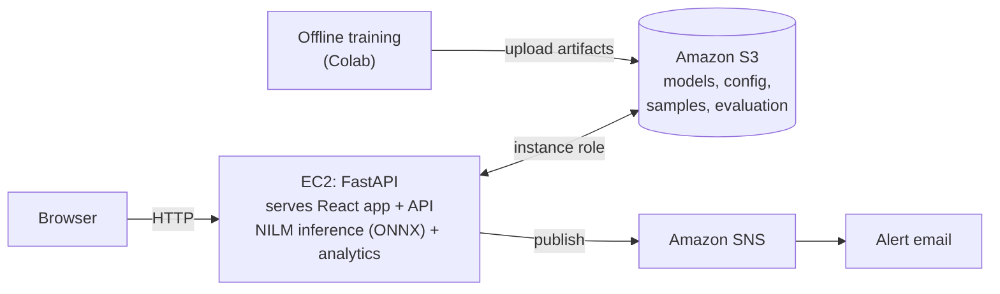

# NILMTrace

**Your bill tells you how much. We tell you why, and what to fix first.**

NILMTrace is a household electricity diagnostic. From one whole-house power signal, it estimates how much energy each major appliance used, flags unusual use, and recommends what to fix first, with the possible ₹, kWh and CO₂ savings.

Built by **Inglorious Momos** for Environmental Hacks × AWS Bharat Builds.

> **Status:** in development. Results below are filled in from the evaluation file once experiments finish. No number in this README is typed by hand.

---

## The problem

An Indian household gets one electricity bill with one number. When it goes up, nobody can tell which appliance caused it, whether that is unusual, or what to do. Finding out today needs a meter on every appliance. So the extra electricity, and its emissions, usually just continue.

## Who it is for

- **Now:** households with a whole-house power sensor that records at least once a minute (for example a clip-on sensor at the main panel).
- **Later:** small businesses (not validated yet).

## What it does

1. **Where your money goes** — estimated kWh, cost contribution and share for each supported appliance.
2. **See the AI work** — the total signal split into appliance estimates, plus the model's evaluation on data it never saw in training.
3. **What changed** — each appliance compared with its own normal week; flagged changes show the likely driver (longer running time, or higher power while running).
4. **What to fix first** — one action per issue, ranked by possible savings, with ₹/kWh/CO₂ ranges.
5. **Alert** — an email when unusual use is detected.

The method is **NILM** (Non-Intrusive Load Monitoring): a neural network learns appliance signatures from a dataset where both the total and each appliance were measured, then estimates appliances from the total alone. Everything after the model (energy, cost, baseline, flags, savings) is deterministic code.

## Architecture



| AWS service | What it does for the product |
|---|---|
| Amazon EC2 | Runs the app: serves the dashboard, runs NILM inference and all analytics |
| Amazon S3 | Stores trained models, the appliance registry, settings, demo samples and the evaluation results; the instance loads them at startup |
| Amazon SNS | Sends the overuse alert email |
| AWS IAM | Instance role and a scoped upload user, so no keys live on the server |

Full design: [ARCHITECTURE.md](ARCHITECTURE.md). Decisions and trade-offs: [DECISIONS.md](DECISIONS.md).

## Data and evaluation

- **Dataset:** iAWE — one household in Delhi, about 73 days, with the whole-house signal and individual appliances measured.
- **Split:** chronological train / gap / test. The test weeks are never used in training.
- **Candidates:** AC, refrigerator, washing machine (and any other usable channel). An appliance is supported only if it passes a recorded GO/NO-GO decision.
- **Metrics, per appliance, on the test weeks:** mean absolute error (W), total and **weekly** energy error (%), ON/OFF F1, each compared with a naive baseline (a fixed share of the total).
- **Downstream check:** an increase is added to one unseen week's real appliance signal; we check whether the flag fires from the **model's estimate**, and whether normal weeks stay unflagged. With about three test weeks this is a sanity check, not statistical validation.

### Evaluation results

*To be filled from `artifacts/evaluation/evaluation.json` (task T-703).*

| Appliance | Decision | MAE (W) model / naive | Weekly energy error, median (%) model / naive | ON/OFF F1 | Downstream check |
|---|---|---|---|---|---|
| — | — | — | — | — | — |

## Environmental impact methodology

1. Excess energy = this week's estimated appliance energy above its normal level.
2. Possible avoided energy per month = excess × 30 ÷ 7, as a range that includes model error.
3. Possible avoided emissions = possible avoided kWh × the Indian grid emission factor from the Central Electricity Authority's CO2 Baseline Database (edition cited in the app).

These are **possible** savings if use returns to its normal level. **No real-world savings or emissions reductions have been measured.**

## Limitations

- Appliance figures are estimates, not measurements.
- Trained and tested on one household; accuracy in other homes is unknown.
- Only appliances that passed GO/NO-GO are supported.
- Needs 1-minute (or faster) whole-house power data for at least 3 weeks; a monthly bill is not enough.
- Effective cost per kWh (bill ÷ units) is an approximation; cost contributions do not reproduce the bill.
- A flag means unusual energy use, not a faulty appliance. More AC use on a hotter week is not waste.
- The "Problem week" demo scenario is simulated from real held-out data.

## Demo (under 3 minutes)

| Time | Step | What we say |
|---|---|---|
| 0:00 | Problem | "One bill, one number. When it rises, nobody knows why." |
| 0:15 | Load **Normal weeks**, enter the bill | "This is one meter's total signal from a real Delhi household, from weeks the model never trained on." |
| 0:30 | Where your money goes | "Each appliance's estimated cost contribution." |
| 0:50 | See the AI work | "Predicted against measured, on unseen data, compared with a naive baseline, week by week." |
| 1:20 | Load **Problem week** | "We simulated a larger AC increase in one unseen week. The flag comes from the model's estimate, not from the injected data." |
| 1:40 | What changed | "AC is up, primarily associated with longer operating time." |
| 1:55 | What to fix first | "One action, and the possible ₹, kWh and CO₂ savings as a range." |
| 2:10 | Alert | The email on a phone (or the saved screenshot). |
| 2:20 | Close | "One meter. We tell you why, and what to fix first. Validated on one house so far; more houses is the next step." |

## Repository layout

```
nilmtrace/
├── README.md  PROJECT.md  ARCHITECTURE.md  REQUIREMENTS.md  TASKS.md
├── DECISIONS.md  TESTING.md  DEPLOYMENT.md  AGENTS.md
├── docs/archive/                 original architecture PDF (reference only)
├── artifacts/                    mirror of the S3 bucket (JSON committed; *.onnx, *.csv ignored)
│   ├── models/registry.json
│   ├── config/settings.json  config/actions.json
│   ├── samples/{normal,problem_week}/scenario.json
│   └── evaluation/evaluation.json
├── backend/
│   ├── requirements.txt
│   ├── app/
│   │   ├── main.py  config.py  schemas.py  pipeline.py  storage.py  alerts.py
│   │   ├── api/routes.py
│   │   ├── ingest/validate.py  ingest/preprocess.py
│   │   ├── nilm/registry.py  nilm/adapters.py  nilm/postprocess.py
│   │   └── analytics/energy.py  cost.py  anomaly.py  recommend.py
│   └── tests/  (fixtures/, fixtures/parity/)
├── ml/
│   ├── requirements.txt
│   ├── prepare_iawe.py  train_seq2point.py  export_onnx.py  evaluate.py  build_samples.py
│   ├── notebooks/
│   └── reports/                  generated reports (data inventory, split, per-appliance eval)
├── frontend/
│   ├── package.json  vite.config.ts  index.html
│   └── src/  (App.tsx, api.ts, types.ts, components/, mocks/)
└── deploy/
    ├── deploy.sh
    └── PREDEMO.md
```

## Running it

- **Local (after artifacts exist):**
  ```bash
  cd frontend && npm ci && npm run build && cd ..
  cd backend && python3.12 -m venv .venv && .venv/bin/pip install -r requirements.txt
  NILM_CACHE_DIR=../artifacts NILM_SYNC_ON_STARTUP=false NILM_ALERTS_ENABLED=false \
    .venv/bin/uvicorn app.main:app --port 8000
  ```
  Open `http://localhost:8000`. Model files are not in git; get them from the team's S3 bucket.
- **AWS:** see [DEPLOYMENT.md](DEPLOYMENT.md).
- **Tests:** see [TESTING.md](TESTING.md).

## Project documents

| File | Purpose |
|---|---|
| [PROJECT.md](PROJECT.md) | Product specification and scope |
| [ARCHITECTURE.md](ARCHITECTURE.md) | Technical design and all contracts |
| [REQUIREMENTS.md](REQUIREMENTS.md) | Acceptance criteria |
| [TASKS.md](TASKS.md) | Build plan |
| [DECISIONS.md](DECISIONS.md) | Decision record, audit, open questions |
| [TESTING.md](TESTING.md) | Verification plan |
| [DEPLOYMENT.md](DEPLOYMENT.md) | AWS runbook |
| [AGENTS.md](AGENTS.md) | Rules for coding agents |

## Data credit

iAWE dataset: Batra et al., Indraprastha Institute of Information Technology Delhi. Cite the dataset paper as its authors request.
