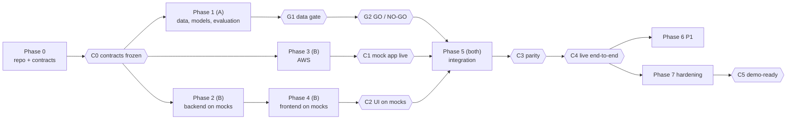

# TASKS.md — Implementation plan

From an empty GitHub repository to a deployed, rehearsed submission.

- **Teammate A** = ML/data. **Teammate B** = backend/cloud (and frontend by default — see U-04 in [DECISIONS.md](DECISIONS.md#4-unresolved-decisions)).
- Tick a box only when the task's **Done when** condition is verifiably true. Nothing is done because the architecture describes it.
- Specs live in [ARCHITECTURE.md](ARCHITECTURE.md); acceptance criteria in [REQUIREMENTS.md](REQUIREMENTS.md); tests in [TESTING.md](TESTING.md); AWS steps in [DEPLOYMENT.md](DEPLOYMENT.md).
- Commands assume bash from the repo root. On Windows PowerShell, use `$env:PYTHONPATH="backend"` instead of `PYTHONPATH=backend`.

## How the two tracks run in parallel

Rough schedule (adjust to your window): **Day 0 evening** Phase 0 + start Phases 1–3. **Day 1** Phases 1–4, reach G2, C1, C2. **Day 2 morning** Phase 5 → C4. **Day 2 afternoon** Phase 7 → C5; Phase 6 only if time remains.

---

## Phase 0 — Foundation (Both)

- [ ] **T-001** · P0 · B · deps: — · Create the public GitHub repo `nilmtrace`.
  Deliverable: repo with the nine docs at root, the original PDF in `docs/archive/`, a `LICENSE` (team's choice).
  Done when: both teammates can push; docs render on GitHub.

- [ ] **T-002** · P0 · B · deps: T-001 · Scaffold the structure of [README.md §Repository layout](README.md#repository-layout) and the `.gitignore`.
  `.gitignore` must include: `.venv/`, `__pycache__/`, `node_modules/`, `frontend/dist/`, `.env`, `*.onnx`, `artifacts/**/*.csv`, `ml/data/`, `ml/out/`, `*.h5`, `.ipynb_checkpoints/`.
  Done when: empty packages exist (`backend/app/__init__.py` etc.) and `git status` is clean after `npm install` / venv creation.

- [ ] **T-003** · P0 · Both · deps: T-001 · Contract review (60 min, together).
  Read ARCHITECTURE §6–§11. Agree on anything unclear and record answers as new `D-xxx` entries. Confirm ownership (ARCH §2) and resolve U-04 (frontend owner).
  Done when: no open questions about the contracts; U-04 has a resolution line.

- [ ] **T-004** · P0 · B · deps: — · AWS account safety (DEPLOYMENT §1): MFA on root, an admin IAM user for daily work, region ap-south-1, a monthly budget with email alert.
  Done when: the budget exists and the alert email address is confirmed.

- [ ] **T-005** · P0 · Both · deps: T-002 · Local environments.
  B: `python3.12 -m venv backend/.venv` and `pip install -r backend/requirements.txt`. A: Colab notebook can clone the repo; local `ml/.venv` with `ml/requirements.txt`.
  Done when: `PYTHONPATH=backend python -c "import app"` works for both.

**Checkpoint C0 — contracts frozen:** T-003 done, T-202 and T-203 merged. From here, contract changes need both teammates and a DECISIONS entry.

---

## Phase 1 — Data, models, evaluation (Teammate A) — critical path

- [ ] **T-101** · P0 · A · deps: T-005 · Download iAWE; write `ml/reports/data_inventory.md`.
  Contents: every channel with its sampling rate and date range; per-day coverage for aggregate and candidates; ON-event counts per candidate; whether the two ACs behave consistently (U-06); any TV/laptop channel worth testing.
  Done when: the report exists and lists candidates with event counts. Resolves U-06.

- [ ] **T-102** · P0 · A · deps: T-005 · Implement `backend/app/ingest/preprocess.py` (ARCH §8) with tests TS-U-01, TS-U-02.
  Done when: `pytest backend/tests/test_preprocess.py` passes.

- [ ] **T-103** · P0 · A · deps: T-101, T-102 · `ml/prepare_iawe.py`: aligned 1-minute dataset (aggregate + candidates) using `preprocess`; chronological split train / gap / test (ARCH §11.2).
  Done when: split dates and `test_weeks_valid` are written to `ml/reports/split.md` and U-02 is resolved.
  **Gate G1:** test period has ≥ 3 valid weeks. If not: shorten training (keep the gap); if still not, record it, and use 2 weeks with baseline = 1 week only after a team decision in DECISIONS.md.

- [ ] **T-104** · P0 · A · deps: T-102 · `backend/app/analytics/energy.py` and `anomaly.py` (ARCH §10.1, §10.2, §10.4–10.6) with tests TS-U-03…TS-U-06.
  Done when: tests pass. (Needed by the downstream check in T-107.)

- [ ] **T-105** · P0 · A · deps: T-103 · Naive baseline + `ml/train_seq2point.py` for the AC (U-05 window). Fixed seed; early stopping on the last part of train.
  Done when: a trained AC checkpoint and its normalisation stats are saved under `ml/out/`.

- [ ] **T-106** · P0 · A · deps: T-105 · Evaluate the AC with ARCH §11.3 metrics vs naive.
  Done when: numbers are in `ml/reports/ac_eval.md` (generated by script, not typed).

- [ ] **T-107** · P0 · A · deps: T-104, T-106 · Downstream check for the AC (ARCH §11.5).
  Done when: result recorded; U-03 proposed values recorded.
  **Gate G2 (AC):** apply ARCH §11.4. Record GO or NO-GO with the reason in DECISIONS.md (U-01). If NO-GO → T-108 becomes P0.

- [ ] **T-108** · P2 (P0 if AC is NO-GO) · A · deps: T-107 · `RuleStepDetector` for the AC, evaluated exactly like T-106/T-107.
  Done when: GO/NO-GO recorded for the rule adapter.

- [ ] **T-109** · P0 · A · deps: T-107 · Train and evaluate the remaining candidates (fridge, washing machine, any from T-101), including downstream checks.
  Done when: each candidate has a recorded GO/NO-GO. ≥ 1 GO overall (ML-06). If 0 GO → stop and apply the cut rule "No GO appliance" below.

- [ ] **T-110** · P0 · A · deps: T-107 (and T-109 per appliance) · `ml/export_onnx.py`: ONNX export (ARCH §9.1), PyTorch-vs-ONNX check (TS-P-01), parity fixtures in `backend/tests/fixtures/parity/`.
  Done when: TS-P-01 passes for every GO model; fixtures committed. Resolves U-10 (else apply D-008 fallback).

- [ ] **T-111** · P0 · A · deps: T-110 · Script writes `artifacts/models/registry.json` (ARCH §7.1), including NO-GO entries with notes.
  Done when: TS-C-02 passes on the registry.

- [ ] **T-112** · P0 · A · deps: T-104, T-110 · `ml/evaluate.py` writes `artifacts/evaluation/evaluation.json` (ARCH §6.8) using backend code; updates `weekly_energy_error_pct` in the registry from the same run.
  Command: `PYTHONPATH=backend python ml/evaluate.py --data ml/data --artifacts artifacts`
  Done when: TS-C-02 passes; `code_version` equals the current commit.

- [ ] **T-113** · P0 · A · deps: T-112 · `ml/build_samples.py` writes `normal` and `problem_week` (ARCH §7.4, §11.8). Choose and cite the illustrative rate with B (U-09).
  Done when: both `scenario.json` validate (TS-C-02); `problem_week.increase_pct` matches the downstream-check value; U-03, U-09 and U-11 resolved.

- [ ] **T-114** · P0 · A · deps: T-111…T-113, T-303 · Upload artifacts.
  Command: `aws s3 sync artifacts/ s3://<bucket>/ --exclude "uploads/*" --profile nilmtrace-ml`
  Done when: `aws s3 ls s3://<bucket>/ --recursive` lists models, samples and evaluation.

- [ ] **T-115** · P1 · A · deps: T-112 · AC rule baseline in evaluation (ML-08).
  Done when: `rule_baseline` is non-null for the AC in `evaluation.json`.

---

## Phase 2 — Backend on mocks (Teammate B)

- [ ] **T-201** · P0 · B · deps: T-005 · `main.py` + `config.py` (ARCH §15) + `/api/health`.
  Command: `cd backend && .venv/bin/uvicorn app.main:app --reload`
  Done when: `curl localhost:8000/api/health` returns JSON; `/docs` lists it.

- [ ] **T-202** · P0 · B · deps: T-003 · `schemas.py` with every model of ARCH §6.
  Done when: models import; field names match ARCH §6 exactly.

- [ ] **T-203** · P0 · B · deps: T-202 · Mock fixtures `frontend/src/mocks/{config,analysis.normal,analysis.problem_week,evaluation}.json` with plausible placeholder values (marked as mock in a top-level comment file `frontend/src/mocks/README.md`), and test TS-C-01.
  Done when: TS-C-01 passes. `analysis.normal` has `issues: []`; `analysis.problem_week` has one issue.

- [ ] **T-204** · P0 · B · deps: T-203 · Endpoints `/api/config`, `/api/analyze/sample`, `/api/evaluation` serving the mocks when `NILM_MOCK=true`.
  Done when: TS-A-01, TS-A-02 (mock mode) pass.

- [ ] **T-205** · P0 · B · deps: T-201 · Serve `NILM_FRONTEND_DIST` at `/` with `index.html` fallback; JSON 404 for unknown `/api/*`.
  Done when: TS-A-05 passes.

- [ ] **T-206** · P0 · B · deps: T-201 · `storage.py`: startup sync S3 → `NILM_CACHE_DIR` (models/, config/, samples/, evaluation/); offline mode when `NILM_SYNC_ON_STARTUP=false`.
  Done when: TS-F-02 passes with moto or by pointing at a non-existent bucket.

- [ ] **T-207** · P0 · B · deps: T-202 · `analytics/cost.py` and `analytics/recommend.py` (ARCH §10.3, §10.7–10.9) with TS-U-07…TS-U-10.
  Done when: tests pass.

- [ ] **T-208** · P0 · B · deps: — · Fill `artifacts/config/settings.json` CO₂ factor and source from the latest CEA CO2 Baseline Database (cite edition and table); review `actions.json` wording (ARCH §7.3, §10.11).
  Done when: U-07 resolved with the citation in DECISIONS.md; TS-U-10 passes on `actions.json`.

- [ ] **T-209** · P0 · B · deps: T-202 · Exception handlers producing `ErrorResponse` (ARCH §6.9); 503 `not_ready` before startup completes.
  Done when: TS-F-04 and TS-F-06 pass.

---

## Phase 3 — AWS (Teammate B) — see DEPLOYMENT.md

- [ ] **T-301** · P0 · B · deps: T-004 · S3 bucket (DEPLOYMENT §2). Done when: Block Public Access on, SSE-S3 on, lifecycle rule on `uploads/`.
- [ ] **T-302** · P0 · B · deps: T-301 · EC2 instance role + policy (DEPLOYMENT §3.1). Done when: role exists with only that policy.
- [ ] **T-303** · P0 · B · deps: T-301 · IAM user `nilmtrace-ml` for A (DEPLOYMENT §3.2); hand keys to A privately. Done when: A runs `aws s3 ls s3://<bucket>/ --profile nilmtrace-ml` successfully.
- [ ] **T-304** · P0 · B · deps: T-004 · SNS topic + email subscription confirmed (DEPLOYMENT §4). Done when: a test publish from the console arrives.
- [ ] **T-305** · P0 · B · deps: T-302 · Launch EC2, attach Elastic IP and role, security group, base packages (DEPLOYMENT §5). Done when: SSH works; `python3.12 --version` and `node --version` (22.x) work on the instance.
- [ ] **T-306** · P0 · B · deps: T-204, T-205, T-305 · systemd service + first deploy in mock mode (DEPLOYMENT §6–7).
  Done when: **Checkpoint C1** — `http://<elastic-ip>/api/health` and the placeholder frontend load from a phone on mobile data.

---

## Phase 4 — Frontend on mocks (Teammate B unless U-04 says otherwise)

Use `frontend-design` guidance; layout of ARCH §13; colours by `color_index`.

- [ ] **T-401** · P0 · deps: T-002 · Vite + React + TypeScript + Tailwind + Recharts; dev proxy `/api` → `localhost:8000`. Done when: `npm run build` succeeds.
- [ ] **T-402** · P0 · deps: T-401, T-202 · `src/types.ts` mirroring ARCH §6 and `src/api.ts` client. Done when: TS-C-03 passes (`npm run typecheck` with mocks typed).
- [ ] **T-403** · P0 · deps: T-402 · Start panel (FR-01, FR-02). Done when: both sample buttons and the bill form work against the mock API, invalid bills blocked.
- [ ] **T-404** · P0 · deps: T-403 · `SummaryBar` + four tabs shell. Done when: switching tabs keeps the analysis.
- [ ] **T-405** · P0 · deps: T-404 · Tab 1 "Where your money goes" (FR-04).
- [ ] **T-406** · P0 · deps: T-404 · Tab 2 "See the AI work": `SignalStack` + `EvaluationPanel` (FR-06, FR-07).
- [ ] **T-407** · P0 · deps: T-404 · Tab 3 "What changed" (FR-08).
- [ ] **T-408** · P0 · deps: T-404 · Tab 4 "What to fix first" + empty state + alert status (FR-09, FR-10, FR-11 UI).
- [ ] **T-409** · P0 · deps: T-404 · `MethodologyDrawer` (FR-12, FR-16).
  Done when (T-405…T-409): each acceptance criterion in REQUIREMENTS §1 is visibly met on mocks at 1280×720. **Checkpoint C2.**

---

## Phase 5 — Integration (Both)

- [ ] **T-501** · P0 · A · deps: T-110 · `nilm/registry.py`, `nilm/adapters.py`, `nilm/postprocess.py` (ARCH §9) with TS-U-11, TS-U-12.
- [ ] **T-502** · P0 · Both · deps: T-501 · Parity test TS-P-02 passes for every GO model. **Checkpoint C3.** Do not continue integration until it passes.
- [ ] **T-503** · P0 · A · deps: T-104, T-207, T-501 · `pipeline.run_analysis` (ARCH §4.2–4.3) with TS-I-01…TS-I-05.
- [ ] **T-504** · P0 · B · deps: T-206, T-501, T-503 · Real `lifespan` startup (ARCH §4.1): sync, load registry, warm-up, precompute samples, health fields.
  Done when: TS-F-01, TS-PERF-01 pass locally with `NILM_CACHE_DIR=../artifacts NILM_SYNC_ON_STARTUP=false`.
- [ ] **T-505** · P0 · B · deps: T-504 · Live `/api/config`, `/api/analyze/sample`, `/api/evaluation` (mock flag off). Done when: TS-A-01…TS-A-03 pass in live mode.
- [ ] **T-506** · P0 · B · deps: T-304, T-505 · `alerts.py` (ARCH §10.10). Done when: TS-F-03 passes; a local run with the real topic sends one email.
- [ ] **T-507** · P0 · B · deps: T-409, T-505 · Frontend on the live API. Done when: the full demo flow works locally on real data.
- [ ] **T-508** · P0 · B · deps: T-114, T-506, T-507 · Deploy to EC2 (DEPLOYMENT §8).
  Done when: **Checkpoint C4** — on the public URL, both samples complete the full flow and the `problem_week` email arrives.
- [ ] **T-509** · P0 if ≥ 2 GO · A · deps: T-508 · Add the second (and further) GO appliance **only** by registry + artifacts + restart.
  Done when: it appears on the dashboard with zero code changes (proves FR-13). Commit hash recorded here.

---

## Phase 6 — P1 polish (only after C4)

- [ ] **T-601** · P1 · B · `ingest/validate.py` + `/api/analyze/upload` (ARCH §6.4, §7.5); set `upload_enabled: true`. Done when: TS-A-04 passes; TS-PERF-03 measured.
- [ ] **T-602** · P1 · B · `CsvUpload` UI with error messages. Done when: each error code shows its message.
- [ ] **T-603** · P1 · B · `ApplianceDrilldown` (FR-05).
- [ ] **T-604** · P1 · B · kWh/₹ toggle on Tab 1.
- [ ] **T-605** · P1 · B · `deploy/deploy.sh` (DEPLOYMENT §8). Done when: one command redeploys and prints the health JSON.
- T-115 (A) is also P1.

---

## Phase 7 — Hardening and submission (Both)

- [ ] **T-701** · P0 · B · Run TS-PERF-01…04 on EC2; record results in DECISIONS.md; resolve U-08 (resize only if NFR-01/02/04 fail).
- [ ] **T-702** · P0 · Both · Run TS-F-01…06 on EC2 or locally as specified.
- [ ] **T-703** · P0 · A · Fill the README "Evaluation results" table **by script or copy from `evaluation.json` only**, and have B check every number against the file. Done when: both have signed off in the PR.
- [ ] **T-704** · P0 · Both · Record the backup demo video (≤ 3:00) from the live URL; store it outside the instance (e.g. a teammate's drive). Capture a screenshot of the alert email.
- [ ] **T-705** · P0 · B · Laptop fallback rehearsal (DEPLOYMENT §11.2). Done when: the demo runs from a laptop with Wi-Fi off after setup.
- [ ] **T-706** · P0 · B · Write `deploy/PREDEMO.md` checklist (DEPLOYMENT §11.1) and run it once.
- [ ] **T-707** · P0 · Both · Two timed rehearsals of the demo script (README §Demo) on the public URL, from a different network, each ≤ 3:00, including rehearsed answers to the judge questions in DECISIONS §1. **Checkpoint C5.**
- [ ] **T-708** · P0 · Both · Submission checklist:
  - [ ] Public repo; README complete; all nine docs consistent with what was built
  - [ ] `git log -p | grep -iE "aws_secret|AKIA"` returns nothing; no `.env`, dataset or model binaries in git
  - [ ] Every P0 in REQUIREMENTS passes; release gates in TESTING §11 pass
  - [ ] DECISIONS.md: every U-xx resolved or explicitly marked "accepted as open" with reason
  - [ ] Demo video link, live URL and repo link in the submission form
  - [ ] Instance left running through judging; budget alert still active

---

## P2 (only if everything above is done)

- T-801 HTTPS (requires reopening D-004).
- T-802 Synthetic appliances through a real trained model (D-029).
- T-803 Result persistence and lookup endpoint.
- T-804 Cross-house check: fridge model on a fridge from another dataset.
- T-805 CloudWatch Logs agent.

---

## Cut rules (apply in order when behind schedule)

1. Drop all P2.
2. Drop P1 in this order: T-604 toggle → T-603 drill-down → T-115 rule baseline → T-601/T-602 upload → T-605 deploy script (deploy by hand).
3. Behind at end of Day 1 with no G2 result: train only the AC; other candidates become "future work" in DECISIONS.md.
4. **No GO appliance (ML-06 fails):** stop feature work. Evaluate the `RuleStepDetector` for the AC (T-108). If that also fails, the team decides explicitly (recorded in DECISIONS.md) whether to present an honest negative result. Never show a NO-GO model as working.
5. **SNS not working by C4:** keep the UI alert status, show the pre-captured screenshot, note it in DECISIONS.md.
6. **EC2 not working by Day 2 midday:** demo from the laptop fallback; keep S3 + SNS in use from the laptop with the team's credentials, and say so honestly.

**Never cut:** the evaluation panel (FR-07), "What to fix first" (FR-09), the possible-savings wording, the methodology drawer with limitations (FR-12), the backup video (T-704).
